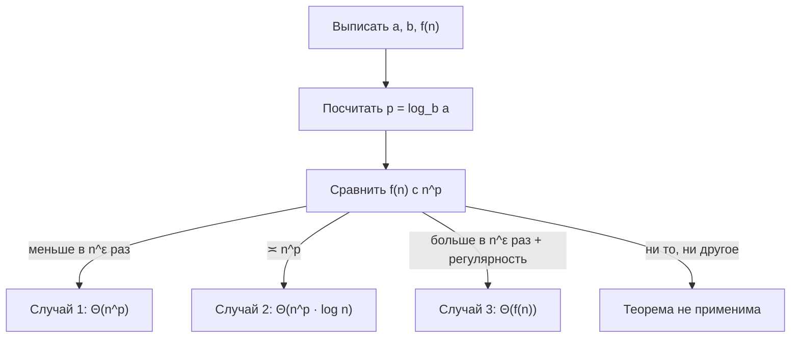

## Формула

$$T(n) = a\,T\!\left(\frac{n}{b}\right) + f(n)$$

| Буква | Смысл |
|---|---|
| $a$ | на сколько подзадач делим |
| $b$ | во сколько раз каждая подзадача меньше |
| $f(n)$ | работа на само деление и склейку (без рекурсивных вызовов) |
| $p = \log_b a$ | «критическая степень»: $n^p$ — работа всех листьев дерева |

Примеры: бинарный поиск $a=1, b=2, f=1$; сортировка слиянием $a=2, b=2, f=n$.

---

## Шаг 1. Дерево рекурсии

Каждая задача рождает $a$ детей, размер каждого в $b$ раз меньше.

| Уровень $j$ | Сколько задач | Размер каждой | Работа всего уровня |
|---|---|---|---|
| 0 | 1 | $n$ | $f(n)$ |
| 1 | $a$ | $n/b$ | $a\,f(n/b)$ |
| 2 | $a^2$ | $n/b^2$ | $a^2 f(n/b^2)$ |
| $j$ | $a^j$ | $n/b^j$ | $a^j f(n/b^j)$ |
| $m$ (листья) | $a^m$ | 1 | $a^m\,T(1)$ |

**Глубина:** $n / b^m = 1 \Rightarrow m = \log_b n$ (как в бинарном поиске, только делим на $b$).

```
                 f(n)                    → f(n)
          /               \
      f(n/b)            f(n/b)           → a·f(n/b)
      /    \            /    \
 f(n/b²) f(n/b²)  f(n/b²) f(n/b²)        → a²·f(n/b²)
    ⋮       ⋮        ⋮       ⋮
 T(1) T(1) T(1) T(1) T(1) T(1) ...       → aᵐ·T(1) = nᵖ·d
                                  (рисунок для a = 2)
```

## Шаг 2. Раскрутка

$$T(n) = a\,T\!\left(\tfrac{n}{b}\right) + f(n)$$

$$= a\left[a\,T\!\left(\tfrac{n}{b^2}\right) + f\!\left(\tfrac{n}{b}\right)\right] + f(n) = a^2 T\!\left(\tfrac{n}{b^2}\right) + a f\!\left(\tfrac{n}{b}\right) + f(n)$$

$$= \dots = a^m\,T\!\left(\tfrac{n}{b^m}\right) + \sum_{j=0}^{m-1} a^j f\!\left(\tfrac{n}{b^j}\right)$$

При $m = \log_b n$:

$$\boxed{T(n) = \underbrace{a^m\,T(1)}_{\text{листья}} + \underbrace{\sum_{j=0}^{m-1} a^j f\!\left(\tfrac{n}{b^j}\right)}_{\text{все остальные уровни}}}$$

Проверка на бинарном поиске ($a = 1$, $f = c$): $\ d + c\log_2 n$. ✓

## Шаг 3. Откуда nᵖ: число листьев

По определению $p = \log_b a$ означает $a = b^p$. Тогда

$$a^m = (b^p)^m = (b^m)^p = n^p, \quad \text{потому что } b^m = n.$$

Пример: $a = 4, b = 2 \Rightarrow p = 2$. При $n = 8$: глубина 3, листьев $4^3 = 64 = 8^2$. ✓

> **Суть теоремы:** сверху работа $f(n)$ (корень), снизу $n^p$ (листья). Кто тяжелее — тот и определяет ответ.

## Шаг 4. Уровни — это геометрическая прогрессия

Пусть $f(n) = n^k$. Работа уровня $j$:

$$a^j \left(\frac{n}{b^j}\right)^k = n^k \cdot \left(\frac{a}{b^k}\right)^j = n^k \cdot q^j, \qquad q = \frac{a}{b^k}$$

Каждый следующий уровень в $q$ раз тяжелее предыдущего. Заметим: $q > 1 \Leftrightarrow k < p$, $\ q = 1 \Leftrightarrow k = p$, $\ q < 1 \Leftrightarrow k > p$.

## Три случая

| | Случай 1 | Случай 2 | Случай 3 |
|---|---|---|---|
| Условие | $f(n) = O(n^{p-\varepsilon})$ | $f(n) = \Theta(n^p)$ | $f(n) = \Omega(n^{p+\varepsilon})$ **и** $a f(n/b) \le c\,f(n),\ c<1$ |
| Уровни | растут вниз ($q > 1$) | все равны ($q = 1$) | убывают вниз ($q < 1$) |
| Кто тяжелее | листья | все поровну | корень |
| Ответ | $\Theta(n^p)$ | $\Theta(n^p \log n)$ | $\Theta(f(n))$ |

### Случай 1 — побеждают листья
Оценка уровня (красная строчка автора): $a^j f(n/b^j) \le C\,a^j (n/b^j)^{p-\varepsilon} = C\,n^{p-\varepsilon}\,(b^{\varepsilon})^j$.
Прогрессия растёт со знаменателем $b^\varepsilon > 1$, в сумме доминирует последний член: $n^{p-\varepsilon} \cdot (b^{\varepsilon})^{m} = n^{p-\varepsilon} \cdot n^{\varepsilon} = n^p$.

### Случай 2 — все уровни поровну
$a^j (n/b^j)^p = n^p (a/b^p)^j = n^p \cdot 1^j = n^p$. Уровней $\log_b n$, значит $T = \Theta(n^p \log n)$.

### Случай 3 — побеждает корень
Регулярность $a\,f(n/b) \le c\,f(n)$ читается так: «работа уровня 1 не больше $c \cdot$ работа уровня 0». Значит каждый уровень меньше предыдущего хотя бы в $c$ раз:

$$f(n)\,(1 + c + c^2 + \dots) = \frac{f(n)}{1-c}$$

Тот же трюк, что $1 + \frac12 + \frac14 + \dots = 2$. Снизу $T \ge f(n)$ (один корень). Итого $\Theta(f(n))$.

### Зачем ε
$\varepsilon > 0$ значит «отличается в $n^\varepsilon$ раз» — полиномиально. Только тогда уровни меняются геометрически. Если разница слабее (например, $f(n) = n^p / \log n$ или $n^p \log n$ в простой версии теоремы), **ни один случай не подходит** — теорема не применима.

---

## Как применять



## Примеры

| Рекуррентность | a | b | f(n) | p | Случай | Ответ |
|---|---|---|---|---|---|---|
| Бинарный поиск | 1 | 2 | 1 | 0 ($n^0 = 1$) | 2 | $\Theta(\log n)$ |
| Сортировка слиянием | 2 | 2 | $n$ | 1 | 2 | $\Theta(n \log n)$ |
| $8T(n/2) + n^2$ | 8 | 2 | $n^2$ | 3 | 1 | $\Theta(n^3)$ |
| $2T(n/2) + n^2$ | 2 | 2 | $n^2$ | 1 | 3 | $\Theta(n^2)$ |
| $4T(n/2) + n^2$ | 4 | 2 | $n^2$ | 2 | 2 | $\Theta(n^2 \log n)$ |
| $3T(n/2) + n$ | 3 | 2 | $n$ | $\approx 1{,}58$ | 1 | $\Theta(n^{\log_2 3})$ |

## Частые ошибки

- Путать $a$ и $b$: $a$ — **сколько** подзадач, $b$ — **во сколько раз** меньше.
- Забывать проверять регулярность в случае 3.
- Применять теорему, когда $f(n)$ отличается от $n^p$ лишь на логарифм.
- Применять к рекуррентностям другого вида, например $T(n) = T(n-1) + n$ — там размер уменьшается вычитанием, а не делением.

## Одной фразой

Время = сумма работы по уровням дерева. Уровни меняются как геометрическая прогрессия: перевешивают листья — $n^p$; все равны — $n^p \log n$; перевешивает корень - $f(n)$.